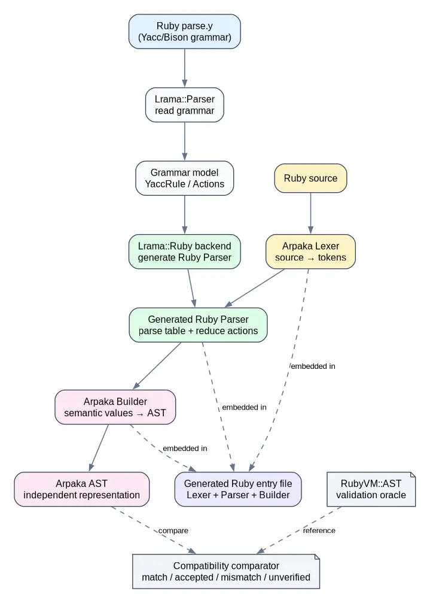

# Arpaka architecture

Arpaka uses Lrama to generate a Ruby parser from Ruby's `parse.y`. The generated
frontend combines a Lexer, the generated Parser, and a Builder, then returns an
Arpaka-specific AST.



## Generation pipeline

The generation pipeline starts with the grammar definition rather than with a
parser implementation written by hand:

```text
parse.y / Yacc grammar
        ↓
Lrama::Parser
        ↓
Grammar model / YaccRule
        ↓
Lrama::Ruby backend
        ↓
Generated Ruby Parser
```

Lrama owns grammar parsing, rule preparation, parser tables, and shift/reduce
execution. The Ruby backend turns those structures into standalone Ruby source.
Grammar actions are embedded as Ruby reduce actions; v1 does not introduce a
language-independent semantic-action IR.

## Runtime pipeline

The generated Parser consumes tokens produced by the Arpaka Lexer. The Builder
turns semantic values produced by reductions into Arpaka AST nodes.

```text
Ruby source → Lexer → Parser → Builder → Arpaka AST
```

The generated Ruby entry file packages these components together. It exposes a
Ruby API for parsing source and does not require the Lrama or Arpaka gems at
runtime.

The Lexer is a separate component because Lrama generates parsers, not Ruby
lexers. It handles Ruby's lexical rules, including strings, interpolation,
regular expressions, percent literals, heredocs, escapes, and context-sensitive
token boundaries.

## Responsibilities

- **Lrama** reads Yacc/Bison grammar, builds the grammar model, computes LALR or
  IELR tables, and executes grammar actions through the generated parser.
- **The Ruby backend** emits the parser table, parser runtime, and Ruby grammar
  actions as Ruby source.
- **The Arpaka Lexer** converts Ruby source into the token stream expected by
  `parse.y`.
- **The Builder** resolves scopes and semantic values and constructs AST nodes.
- **The Arpaka AST** represents Ruby syntax and the semantic information needed
  by later consumers. It is an independent representation, not a copy of
  RubyVM's internal node layout.
- **The compatibility comparator** uses RubyVM::AST as an Oracle for finding
  missing or incorrectly interpreted information. It allows representation
  differences when the meaning is equivalent.

## Profiles and Actions

Ruby's grammar changes across versions. Profiles select the source revision,
runtime features, and Action mappings for a particular grammar. Rule signatures
are used where numeric rule IDs are unstable; legacy profiles retain mappings
for older Ruby grammars.

An Action in v1 means the semantic action attached to a Yacc grammar rule. The
profile maps that action to Ruby Builder code. A common semantic-action adapter
between grammar actions and language-specific Builders is a possible future
extension, but it is not required by the v1 architecture.

## AST and validation

Arpaka's AST is designed for a Ruby frontend, so node names and wrappers do not
need to match RubyVM::AST exactly. RubyVM::AST provides an Oracle for checking
whether the frontend preserves relevant syntax and meaning. The comparator
classifies results as `match`, `accepted_mismatch`, `mismatch`, or `unverified`.

Some RubyVM metadata is intentionally outside the v1 AST contract. Examples
include information whose meaning is tied to RubyVM internals or cases where
the reference AST does not expose enough information to distinguish two
representations. Those cases remain explicitly classified instead of being
silently accepted.

## Scope of v1

v1 targets Ruby 4.0's `parse.y` and provides a generated Ruby frontend with a
Lexer, Parser, Builder, and independent AST. Ruby 3.3 and 3.4 profiles are
additional compatibility targets. Broader version support, language-neutral
semantic actions, and other-language backends can be introduced later without
making them prerequisites for the v1 frontend.
